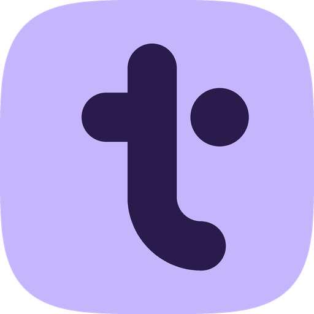

<p align="center">
  
</p>

<h1 align="center">TapKey</h1>

<p align="center">
  <strong>Right-click, scroll and drag — by touch.</strong><br>
  A tiny Windows tray utility that adds a touch-friendly mouse overlay to Moonlight streaming.
</p>

<p align="center">
  <a href="https://crowking63.github.io/TapKey/">Project page</a> ·
  <a href="docs/spec.md">Design notes</a> ·
  <a href="docs/tap-signature.md">Measured tap data</a> ·
  <a href="LICENSE">MIT License</a>
</p>

---

## Why

When you control a PC through [Moonlight](https://moonlight-stream.org/) from a touch
device — say, an iPad while wearing a Vision Pro as the display — touch maps to the
mouse, but **right-click, wheel scroll and precise drag** are painful: long-press
right-click is timing-sensitive, and there is no scroll at all in touch mode.

TapKey runs on the **PC side** and watches the mouse hook. Your single taps pass
through untouched. **Double-tap the same spot** and a small translucent button panel
appears right next to the tap point — tap a button to perform the missing mouse
action *at that spot*.

No client fork, no fixed macro panel, no game-style HUD. It works with any streaming
client that injects standard mouse input.

## What you get

A 2×3 overlay at the double-tap point:

| Button | Action |
|---|---|
| **Hold2s** | press & hold the left button for 2 seconds |
| **RClick** | right-click (context menu) |
| **Drag** | opens a D-pad: plan a path with direction taps, then replay it as a real drag |
| **Scr Up / Scr Dn** | wheel scroll (2 notches per tap); the panel stays open for repeat taps |
| **DblClk** | proper double-click — open files, since a fast double-tap is the overlay trigger |

- **Single taps are never delayed or swallowed.** Only the second tap of a same-point
  double-tap is consumed; a false trigger is just a popup you dismiss with one
  outside click.
- **Drag without steady hands:** the D-pad plans the path first (zero mouse events
  while planning), then replays it as one smooth drag — move icons, select text,
  drag windows.
- **Semi-transparent lavender panel** that stays readable over the stream, with
  large touch targets and bold icons.
- **Tray-resident, portable:** one exe + `tapkey.toml` next to it. Tap the tray icon
  to open settings — trigger window, tap radius, idle close, pause/resume, quit.
  Changes apply instantly and auto-save; the folder carries its settings.
- **Multi-monitor aware:** overlays stay on the tapped monitor; drag replay spans
  the whole virtual desktop.

## How it works

```
touch → Moonlight → Windows mouse events
                        ↓
            TapKey (WH_MOUSE_LL hook)
              ├─ tap 1 → passes through
              └─ tap 2, same point ≤250 ms → swallowed → overlay opens at that point
overlay button tap → SetCursorPos(anchor) + SendInput → action lands where you double-tapped
```

The overlay is a raw Win32 layered window (Rust + [windows-rs](https://github.com/microsoft/windows-rs),
no UI framework), so it is captured by Moonlight and shows up in your stream like
any other window. Architecture and implementation notes: [docs/spec.md](docs/spec.md).

## Requirements

- Windows 10/11 x64 (the hook and layered-window APIs are Windows-only)
- A Moonlight host setup (or any remote-input source that injects mouse events)
- To build: Rust (GNU toolchain) + mingw-w64 `gcc`/`windres` on PATH

## Download & run

Grab the latest `tapkey-*-windows-x64.zip` from [**Releases**](https://github.com/CrowKing63/TapKey/releases),
unzip to any writable folder and run `tapkey.exe` — it starts in the tray. No installer, no runtime.

> The exe is unsigned, so Windows SmartScreen may show an "unknown publisher" warning:
> **More info → Run anyway**. Releases are built from the tagged source by GitHub Actions.

## Build from source

```bash
cd src/tapkey
cargo build --release
# run target/release/tapkey.exe  (kill any running tapkey first — it locks the link)
```

The release exe is ~400 KB with LTO + strip and imports only Windows system DLLs.
It starts in the tray (no console window). On Windows 11 the icon lands in the tray
overflow — drag it out for one-tap access.

**Usage:** double-tap the same spot → overlay appears → tap a button. Tap outside
the panel (or wait 8 s) to dismiss. Tray tap → settings. `Esc` on the main panel
quits; `Esc` on the D-pad returns.

## Configuration

`tapkey.toml` next to the exe (created on first settings change; defaults otherwise):

```toml
double_tap_window_ms = 250   # t1→t2 trigger window (20–1000)
tap_radius_px = 0            # same-point radius (0–20; 0 = exact match)
overlay_idle_ms = 8000       # idle auto-close (1000–60000)
anchor_dot_px = 20           # anchor dot diameter (4–100)
detection_enabled = true     # global pause switch
```

**Tuning the trigger:** natural double-tap rhythm varies per person and per device.
Measured iPad + Moonlight data and window/recall trade-offs:
[docs/tap-signature.md](docs/tap-signature.md). If double-taps miss, raise the window;
if the popup appears on plain re-taps, lower it. False triggers are harmless by
design — nothing is ever swallowed except the trigger tap itself.

## Limitations

- **UIPI:** actions cannot be injected into apps running as administrator unless
  TapKey is also elevated.
- **Timing overlap:** no window value perfectly separates intended double-taps from
  natural re-taps; the pass-through model keeps the cost of a miss at "a popup
  appeared".
- Multi-monitor support is implemented; real dual-display / mixed-DPI verification
  is still pending.
- The low-level hook receives no events inside Windows Sandbox / VMs — test on real
  hardware.

## Repository layout

| Path | What |
|---|---|
| `src/tapkey` | the app (Rust + windows-rs): hook, overlay, D-pad, tray, settings, portable config |
| `src/taplogger` | observe-only tap measurement tool used to produce the tap-signature data |
| `src/TapKey.PoC` | legacy C#/WinForms proof of concept, kept as a minimal hook reference |
| `docs` | design notes, measured tap data, project page (`index.html`) |
| `scripts` | icon rendering script (shared design space with the tray renderer) |

## License

[MIT](LICENSE)